<div align="center">

<picture>
  <source media="(prefers-color-scheme: dark)" srcset="assets/banner-dark.svg">
  
</picture>

<p>
  
  
  
  
  
  
  
  <a href="https://github.com/zyvorai/zyvor-zyvora-site/releases/latest"></a>
</p>

<p>
  <a href="https://zyvora.zyvor.dev/"></a>
  <a href="#try-it-in-about-five-minutes"></a>
  <a href="docs/README.md"></a>
  <a href="docs/SECURITY-OVERVIEW.md"></a>
  <a href="https://github.com/zyvorai/zyvor-zyvora-site/releases"></a>
</p>

### Intelligence for a Healthier World.

**Patients, wards, lab, pharmacy and billing in one secure place, with assistance that drafts and people who decide.**

<sub>Registry · Scheduling · Notes and charts · Prescribing · Emergency · Wards and theatre · Discharge · Lab and analysers · Imaging · Pharmacy · Billing and collections · Claims · Follow-up and care programmes · Patient portal · Audit · FHIR · Integration hub · Propose-only assistants</sub>

</div>

> [!IMPORTANT]
> **ZYVORA is pilot-ready software, not a certified medical product.** It has been built and tested with **synthetic data only**. It makes **no** clinical-validation, regulatory-certification, HIPAA/GDPR/ABDM-compliance or live-integration claim beyond what is stated, with its evidence, in the [intended use and limits](docs/INTENDED-USE.md). Please do not use real patient data.

This repository is the **public home of the ZYVORA website, its one-command installer and its release notes**. There is no application source here; the product repository is private.

---

## What it does

<picture>
  <source media="(prefers-color-scheme: dark)" srcset="assets/capabilities-dark.svg">
  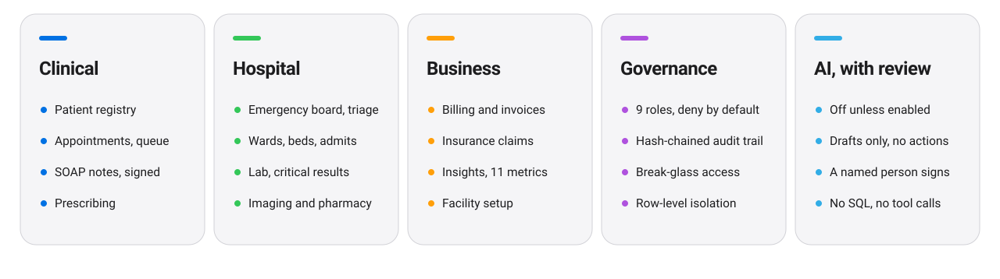
</picture>

Every module, in plain words: **[Modules](docs/MODULES.md)**.

## Try it in about five minutes

One command, a hospital full of invented patients to look around, **no sign-up, nothing to buy, and nothing leaves your machine.**

```bash
# Mac or Linux. Open a terminal, paste, press Return.
curl -fsSL https://github.com/zyvorai/zyvor-zyvora-site/releases/latest/download/get.sh | sh -s -- up --demo --seed
```

```powershell
# Windows (PowerShell). Runs ZYVORA inside WSL 2. Not yet verified on a Windows PC.
& ([scriptblock]::Create((irm https://github.com/zyvorai/zyvor-zyvora-site/releases/latest/download/get.ps1))) up --demo --seed
```

The installer downloads two small images, starts ZYVORA, loads invented patients and opens your browser. If there is no container engine it **asks** before setting one up. Your browser warns about a self-made certificate once; the address is your own computer. Choose **Continue with single sign-on**, then **Dr. Meera Rao**. There is no password in the demo.

Want to read the installer first? It is short and only writes under `~/.zyvora`. See **[Getting started](docs/GETTING-STARTED.md)** for the safe way to do that, the **doctor's test drive** (eight things, about ten minutes), and how to remove everything with one command. Stuck? **[Troubleshooting](docs/TROUBLESHOOTING.md)**.

---

## See it

Real screens from the running application. Every patient, result and number is synthetic. Light and dark follow your system setting.

<picture>
  <source media="(prefers-color-scheme: dark)" srcset="shots/hero-dark.jpg">
  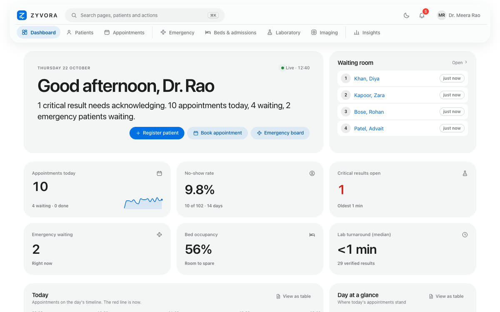
</picture>

**The day at a glance.** Today's timeline, the waiting room, trends and bed occupancy.

| Lab results in context | Insights | Beds and wards |
|:---:|:---:|:---:|
| <picture><source media="(prefers-color-scheme: dark)" srcset="shots/dark-lab.jpg">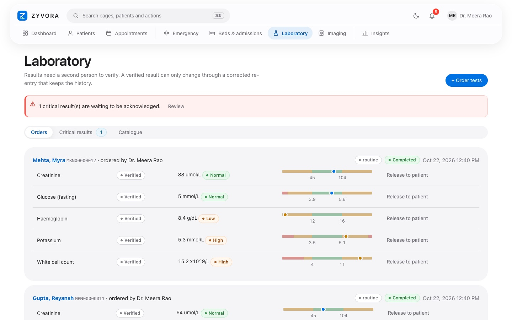</picture> | <picture><source media="(prefers-color-scheme: dark)" srcset="shots/dark-insights.jpg">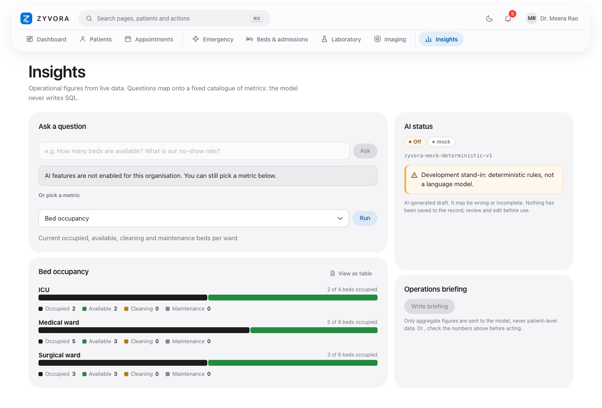</picture> | <picture><source media="(prefers-color-scheme: dark)" srcset="shots/dark-beds.jpg">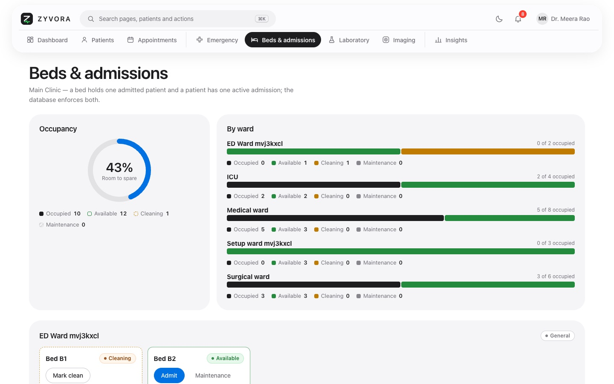</picture> |
| Every value against its reference range | A closed catalogue of eleven metrics; no model-written SQL | Occupancy and a bed map per ward |

<details>
<summary><b>More screens and short recordings</b></summary>

| | |
|---|---|
| <picture><source media="(prefers-color-scheme: dark)" srcset="shots/dark-emergency.jpg">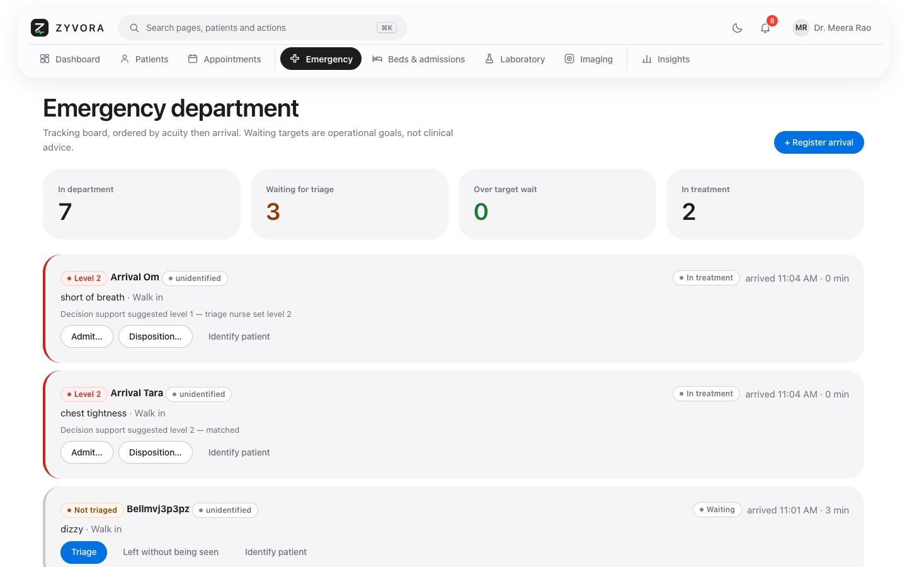</picture><br><b>Emergency</b> | <picture><source media="(prefers-color-scheme: dark)" srcset="shots/dark-encounter.jpg">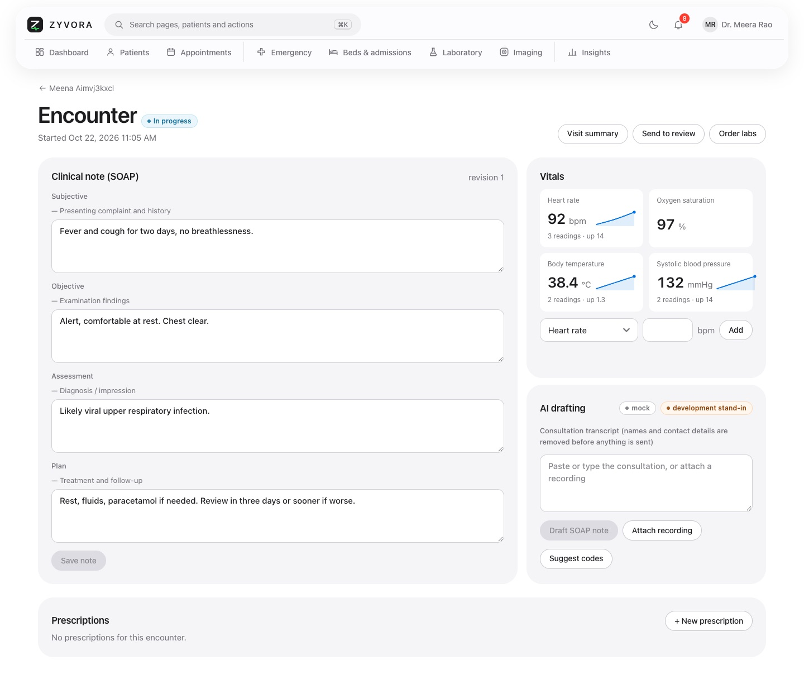</picture><br><b>Encounter</b> |
| <picture><source media="(prefers-color-scheme: dark)" srcset="shots/dark-billing.jpg">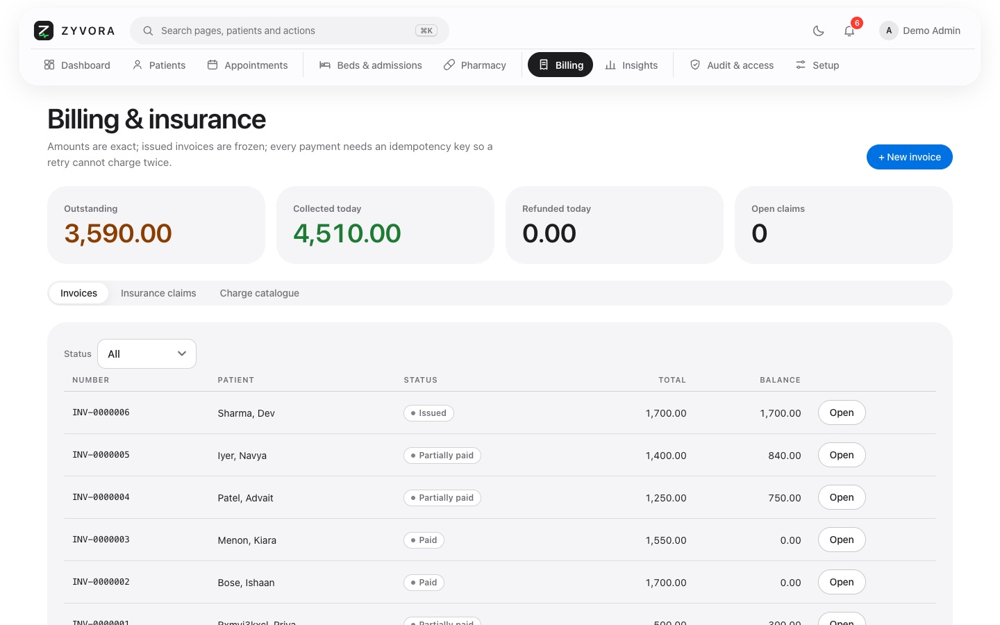</picture><br><b>Billing</b> | 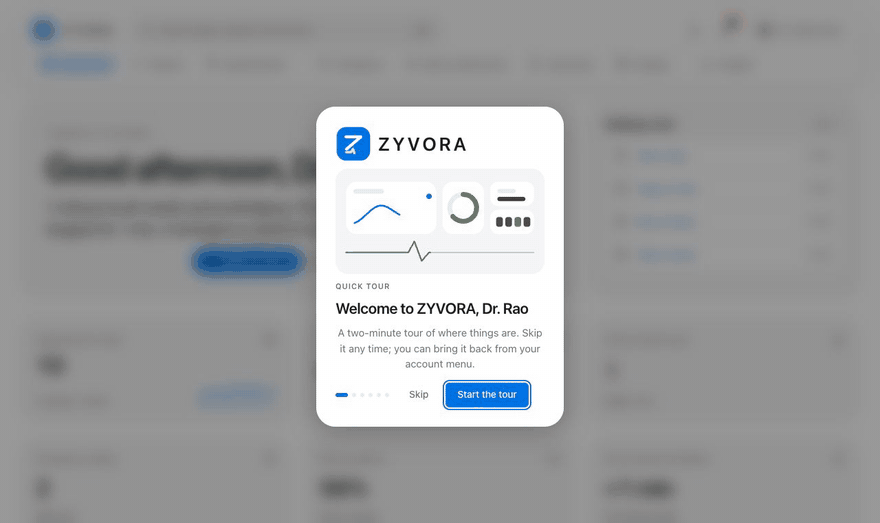<br><b>Welcome tour</b> |
| 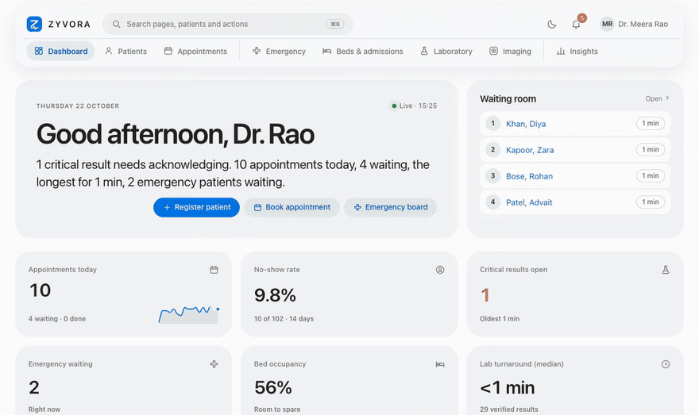<br><b>Command palette</b> | 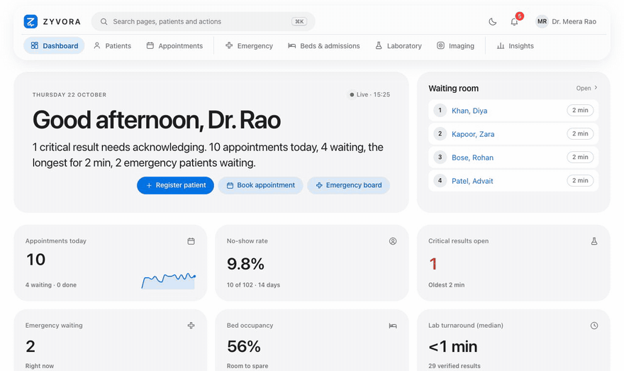<br><b>Light and dark</b> |

Everything, in one place: **[Gallery](docs/GALLERY.md)**.

</details>

## Why ZYVORA

| When this happens | ZYVORA gives you |
|---|---|
| A patient is registered twice, or a slot is double-booked | Database-guaranteed no double-booking; gap-free patient numbers per organisation |
| A critical lab result sits unseen | Separate entry and verification, a critical-result alert, an acknowledgement on the record |
| Someone needs a record they should not normally see | Break-glass access with a stated reason, reviewed by an administrator, all on the audit trail |
| Someone asks "who looked at this chart?" | A hash-chained, append-only audit trail written in the same transaction, with a verify endpoint |
| An assistant suggests a note | A draft only: no actions, no tools, identifiers removed first, and a named clinician must review it before it counts |
| The network drops mid-note | Encrypted offline drafts on the device that sync later (note drafts only, up to 12 hours) |

## How it fits together

<picture>
  <source media="(prefers-color-scheme: dark)" srcset="assets/architecture-dark.svg">
  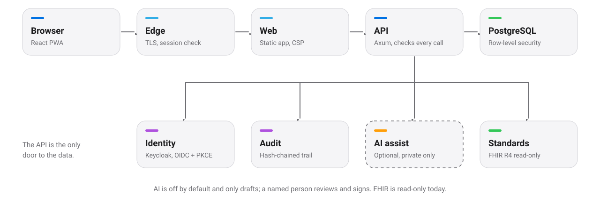
</picture>

A modular monolith: one Rust service in front of PostgreSQL, a React progressive web app, and nothing else you must run. Every request is authenticated and authorised by the API itself; the optional Envoy edge is a second layer, not the only one.

## Security and privacy

<picture>
  <source media="(prefers-color-scheme: dark)" srcset="assets/security-dark.svg">
  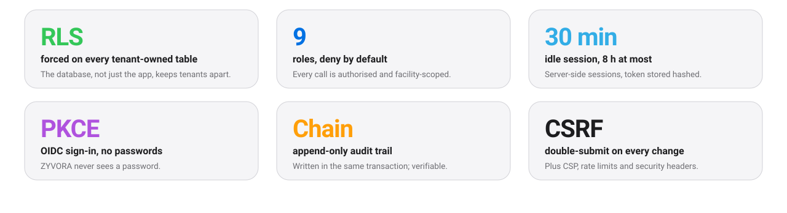
</picture>

<picture>
  <source media="(prefers-color-scheme: dark)" srcset="assets/roles-dark.svg">
  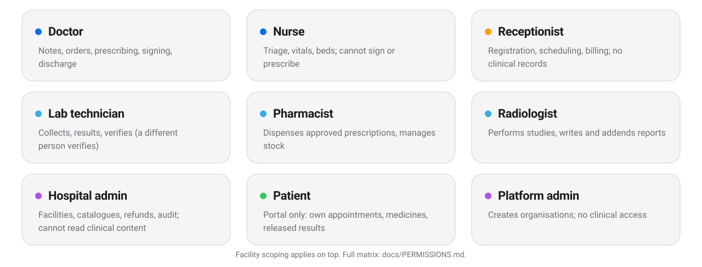
</picture>

Tenant isolation is enforced by the database (row-level security on every tenant-owned table). Sign-in is OIDC authorization code with PKCE; sessions are server-side, hashed, 30 minutes idle and 8 hours at most. **[Security overview](docs/SECURITY-OVERVIEW.md)** lists each control and, just as plainly, what has **not** been done. To report a vulnerability, read [SECURITY.md](SECURITY.md).

## Run it your way

<picture>
  <source media="(prefers-color-scheme: dark)" srcset="assets/deploy-dark.svg">
  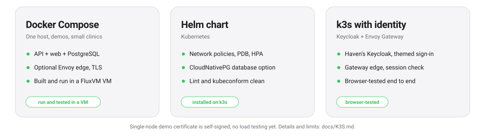
</picture>

The same two container images run on **Docker Compose**, on **Kubernetes** with a Helm chart, or on **k3s** with Keycloak sign-in and an Envoy Gateway edge. PostgreSQL 14 to 18. Images: `ghcr.io/zyvorai/zyvora-api` and `ghcr.io/zyvorai/zyvora-web` (`linux/amd64` and `linux/arm64`). Release files and how to verify them: **[Releases](docs/RELEASES.md)**.

## Honest limits

- **Synthetic data only.** Not certified against HIPAA, GDPR, ISO 27001, SOC 2, IEC 62304, NABH/JCI or similar; a gap list is published.
- **No independent penetration test yet.** The audit trail is tamper-evident, not tamper-proof against a database owner.
- **No clinical validation of any model.** Drug-interaction and dose checks report `unavailable` where there is no drug database; they never say "passed".
- **Integrations.** FHIR R4 is read-only. Only FluxVM has been verified live; Netra and Nuvora are tested against stand-ins.
- **Not built yet:** automated backups, critical-result paging, e-prescription, a payment gateway, patient self-booking, languages other than English, a native mobile app.

The whole list, with the reasoning: **[Intended use and limits](docs/INTENDED-USE.md)**. Pricing has not been decided and there are no customer stories yet; the website says so.

---

## Documentation

| | |
|---|---|
| [Getting started](docs/GETTING-STARTED.md) | Install the demo, the doctor's test drive, remove it again |
| [Troubleshooting](docs/TROUBLESHOOTING.md) | The browser warning, a busy port, Windows first run, proxies |
| [FAQ](docs/FAQ.md) | Certification, AI, where data lives, sign-in, integrations |
| [Modules](docs/MODULES.md) | What every module does |
| [Security overview](docs/SECURITY-OVERVIEW.md) | Controls you can point at, and what is out of scope |
| [Intended use and limits](docs/INTENDED-USE.md) | What ZYVORA is not, yet |
| [Releases](docs/RELEASES.md) | What is in each release, verifying downloads, upgrade, backup and restore |
| [Gallery](docs/GALLERY.md) | Every screen and recording |
| [One-page sheets (PDF)](resources/) | Executive overview, security and privacy posture, architecture and deployment, module guide, integration matrix |

## Part of the Zyvor platform

| Product | Role next to ZYVORA |
|---|---|
| **Haven** | Identity: the Keycloak packaging ZYVORA signs in through |
| **Nuvora** | Self-hosted AI platform with an OpenAI-compatible API, the preferred model back end (tested against a stand-in) |
| **Netra** | The console whose design language ZYVORA follows; an optional integration |
| **FluxVM** | Virtual-machine control plane; read-only status adapter, verified live |

## Feedback and contact

- **Pilots and demos:** [sales@zyvor.dev](mailto:sales@zyvor.dev?subject=ZYVORA%20pilot)
- **Security:** [security@zyvor.dev](mailto:security@zyvor.dev)
- **GitHub issues** are welcome for feedback on the demo. **Never include patient data or credentials.** See [CONTRIBUTING.md](CONTRIBUTING.md).

---

<div align="center">

<sub>ZYVORA is built by [Zyvor AI Labs](https://zyvor.dev). The website files in this repository are generated from the product repository and are not edited by hand here. © 2026 Zyvor AI Labs. All rights reserved; ZYVORA is proprietary software and no application source is published. Synthetic data only · Not a certified medical product.</sub>

</div>
