# Gallery

**Pilot-ready software, not a certified medical product. Synthetic data only.**

Real screens and recordings from the running application. **Every patient, result and number is synthetic.** Dark first, then light.

## Dashboard

Today's timeline, waiting room, trends and bed occupancy.

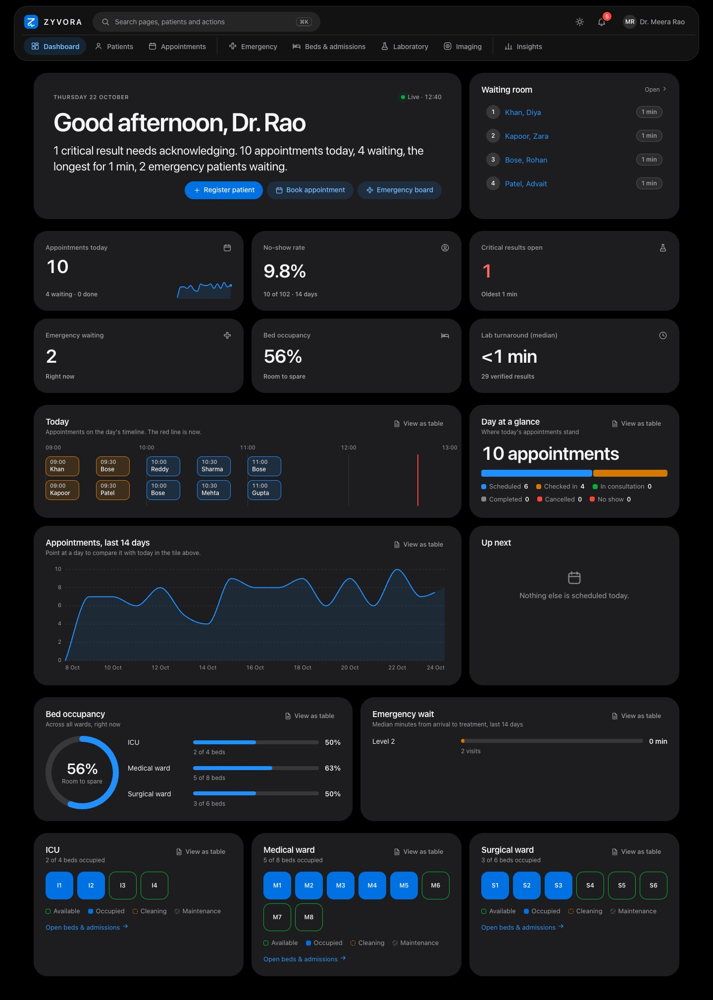

Light mode

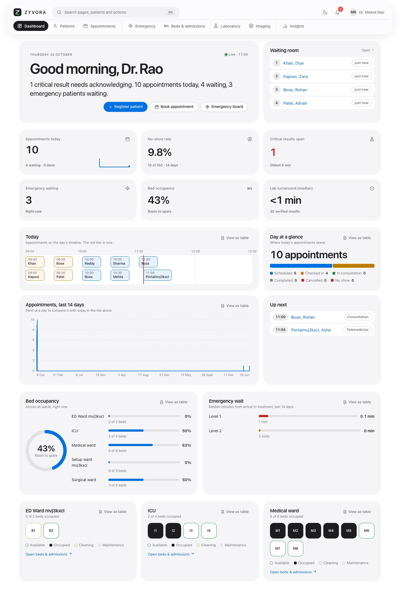

## Emergency

Arrivals by urgency, with triage and bed placement.

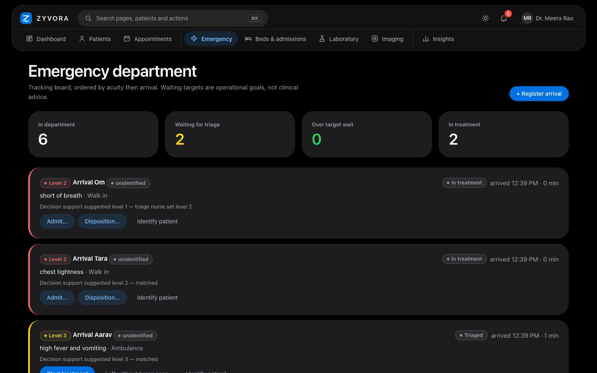

Light mode

## Encounter

A SOAP note with every revision kept, vitals and prescribing.

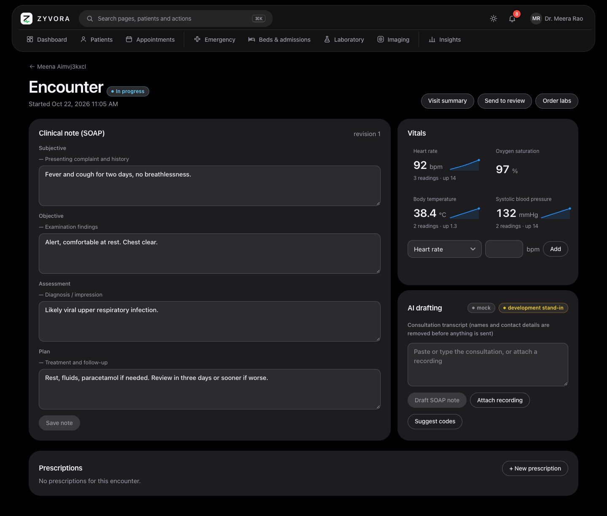

Light mode

## Laboratory

Results drawn against their reference ranges, with critical alerts.

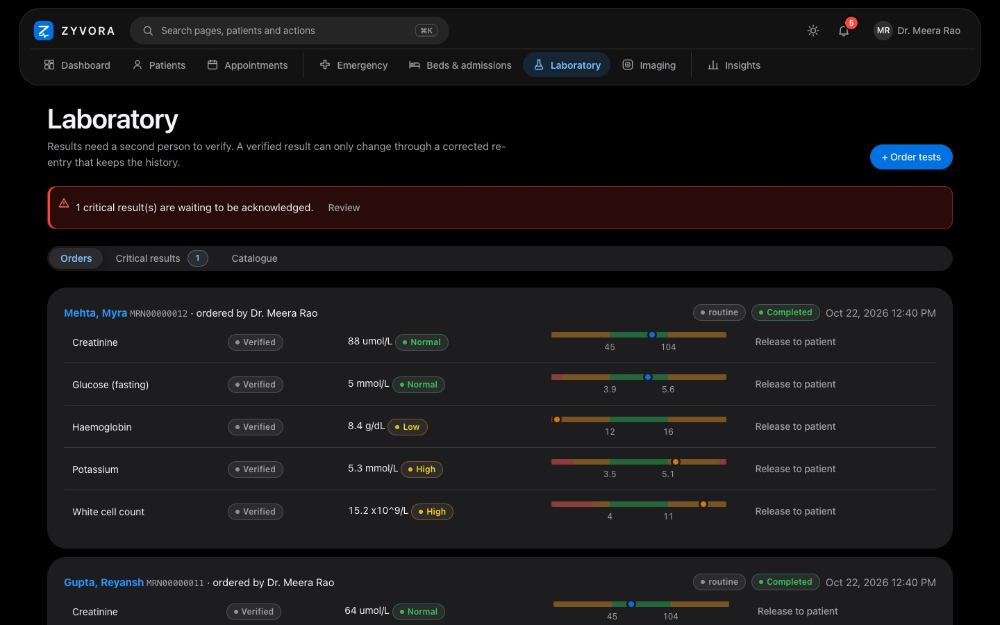

Light mode

## Beds and wards

Ward occupancy and a bed map per ward.

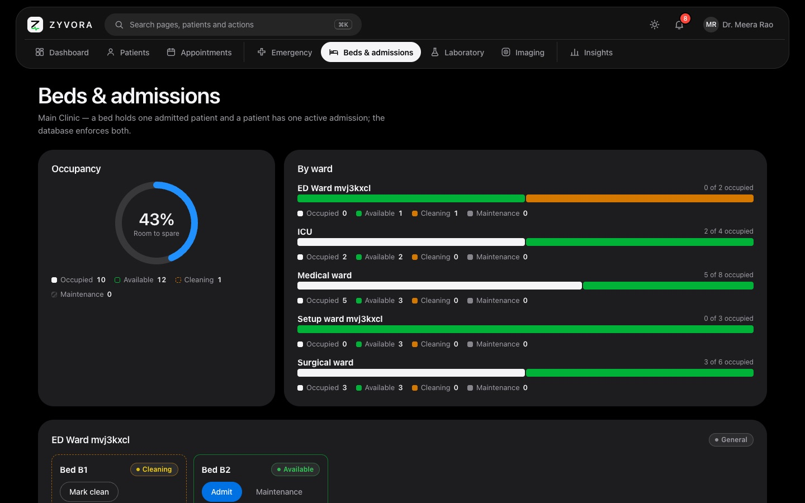

Light mode

## Billing

Exact money, tax rules held as data, idempotent payments.

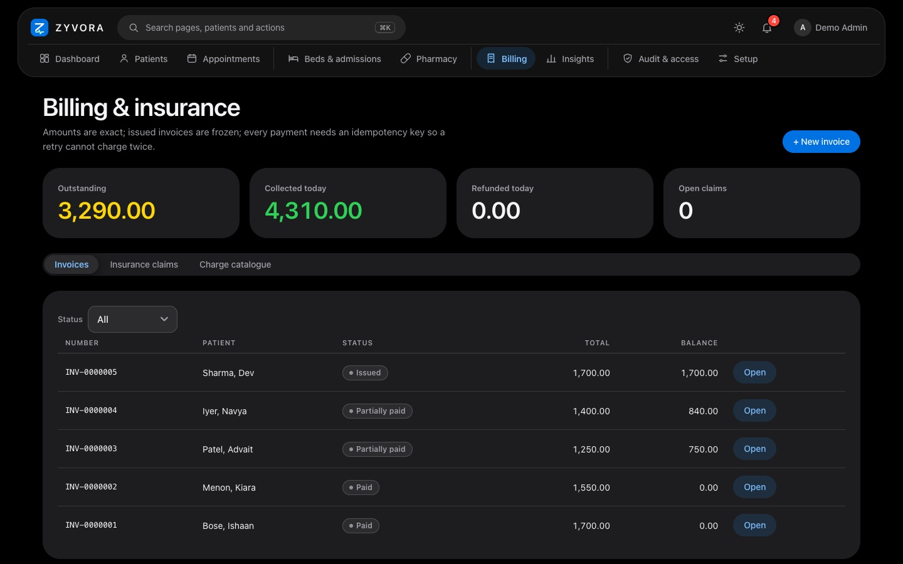

Light mode

## Insights

A closed catalogue of eleven metrics; no model-written SQL.

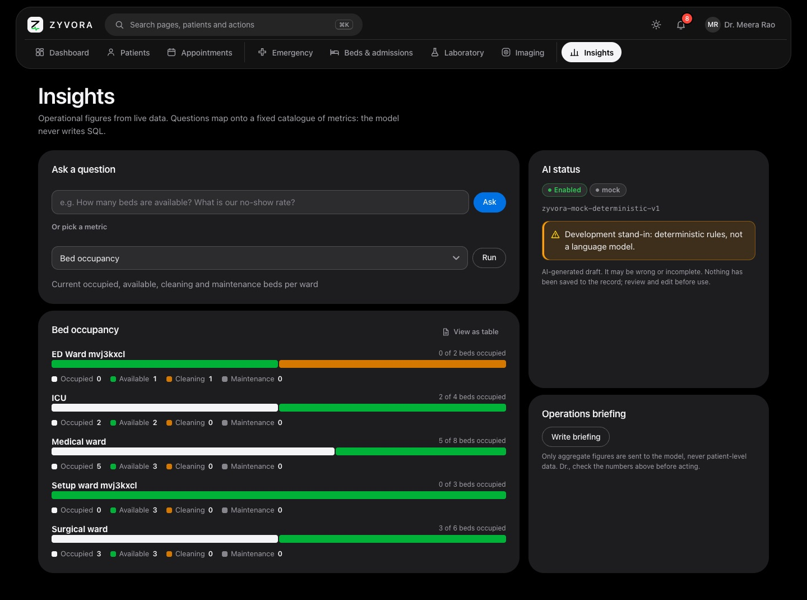

Light mode

## Short recordings

Silent recordings of the running app (synthetic data).

### Welcome tour

The tour spotlighting the menu, search and notification bell.

### Command palette

Finding Beds and admissions as the word bed is typed.

### Beds and wards

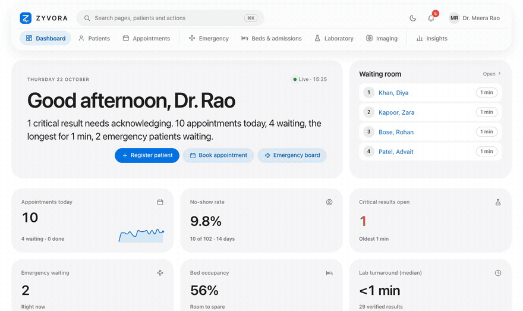

Ward occupancy and bed maps scrolling into view.

### Laboratory

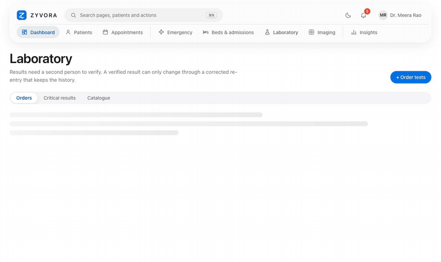

Laboratory work list and results.

### Light and dark

The dashboard switching from light to dark and back.

### Install: the terminal

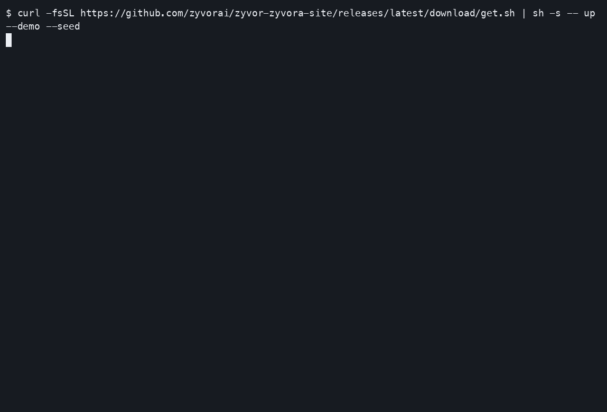

The one-command install, recorded from a real run.

### Install: the browser

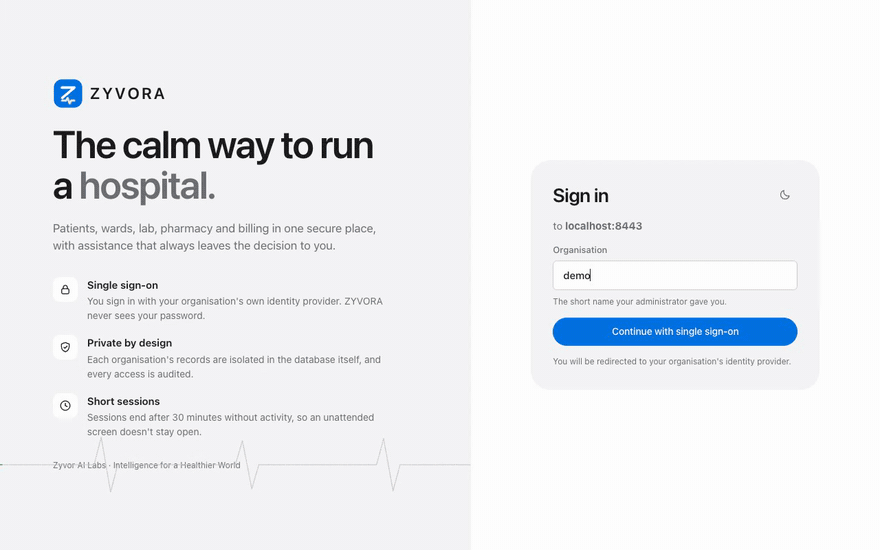

Signing in as a demo doctor after the install.

Back to the [documentation index](README.md).
